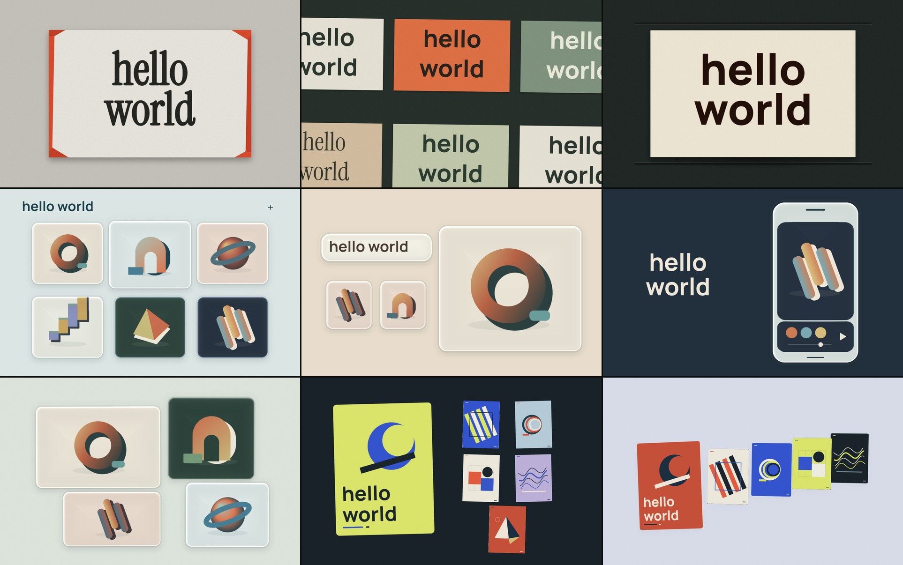

# Animation Card

85 editable motion cards, all drawn on `<canvas>`. No video, no textures, no external dependencies.

One 448 KB HTML file. Double-click it and it runs.

**[▶ Live demo](https://mlf631666711-cloud.github.io/Animation-Card/)** · [Card index](CARDS.md) · [中文](README.md)



---

## What this is

Not an asset pack. Each of the 85 cards is its own chunk of canvas drawing code, sharing one `draw(ctx, t)` signature and driven by a time value.

That means once you open it you can:

- Drag the timeline and look at any single frame
- Jump beat by beat — every card is cut into 4–7 labelled segments
- Hit 「源码」 (source) in the top right to read, copy or download the full drawing code for that card
- Hit 「保存动效」 (save) to export the current card as a standalone HTML file

The second and third points are what separate this from a normal motion preview. The motion is described as structure you can repeat out loud, not as a video you can only watch.

## What a card is made of

Each card carries fields that describe the relationship between frames, not what it looks like:

| Field | What it answers | Example (card 32, "Glass gate wipe") |
|---|---|---|
| **From** | Where it comes from | Dark two-column: work left, title right |
| **To** | Where it lands | Three light cards become a primary / secondary layout |
| **Shared anchor** | What carries into the next shot | The gate's right edge ends the old shot and reveals the new one at once |
| **Prep** | The beat just before entry | (Only 15 cards have this) |
| **Beats** | How many internal segments | 6 |
| **Kind** | Its job in a finished cut | Transition |

**55 cards fill in the first three fields.** The single-technique cards 1–20 never had semantic segment data in their original design, so the player shows them as time percentages instead of inventing "action nodes". That's a gap, not an omission.

Beats are readable individually. Card 32 again:

| Beat | Time | Label |
|---|---|---|
| 01 | 0.00s | Two columns set |
| 02 | 1.35s | Gate wipes across |
| 03 | 2.65s | Three cards catch |
| 04 | 3.70s | Primary / secondary reflow |
| 05 | 5.20s | Result settles |
| 06 | 7.30s | Reverse hand-off |

## Six collections

| Collection | Count | Length | Purpose |
|---|---:|---|---|
| Basic studies | 20 | 6s | One technique each, no scene packaging |
| Sequences | 10 | 9.6s | A single technique stretched into a multi-beat narrative |
| Scenes & components | 15 | 8.6–9.4s | Interface-level motion: card into detail, window yields, multi-window collapse |
| Quick cuts | 15 | 6–7.4s | Whip, bounce, frame-pass, snap. Carries a cut in dense editing |
| Pure typography | 15 | 3.4–4.8s | Type and a solid background only. No cards, panels or ornament |
| Type in space | 10 | 5.9–6.5s | Type as a spatial subject: orbit, depth relay, tilt, grazing angles |

Full list and per-card recipes are in [CARDS.md](CARDS.md).

## Controls

Open `index.html`. Keyboard:

| Key | Action |
|---|---|
| `Space` | Play / pause |
| `←` `→` | Frame step |
| `Shift` + `←` `→` | Second step |
| `1`–`9` | Jump to beat N |
| `R` | Replay |
| `F` | Fullscreen |

URL parameters address a specific frame, useful for embedding:

```
index.html?card=33&t=2.4          # card 33, holding at 2.4s
index.html?card=33&bare=1&t=2.4   # same, all controls hidden
```

## Files

```
index.html      85 cards + player + source viewer, single file, 448 KB
CARDS.md        Card index + full recipes for 55 cards
cards.json      Machine-readable card data (names, kind, length, beats, recipe fields)
assets/         Preview image and three motion GIFs
```

There is not a single `src=` or `href=` in `index.html` pointing at an external file. Fonts, styles and code are all inline, so it opens offline.

## Known limits

- **Cards 1–20 have no semantic beats**, only time-percentage markers
- **Everything is drawn with `hello world` and one set of geometric shapes.** The whole library shares a single test content set. That's deliberate — the same content is the only way to see the motion itself — but it also means it looks repetitive
- **An exported single card can't edit its recipe.** The exported HTML holds that card's drawing code only, without the player or the index
- It opens on mobile, but the controls were designed for a desktop keyboard

## Credits and license

The code is written here. Every card under `collections/` and `type/` is independent canvas drawing; no video, screenshot or third-party renderer is referenced.

The four embedded fonts (Lab Grotesk / Lab Serif / Lab Condensed / Lab Mono) are distributed under the **SIL Open Font License 1.1**, with the full license text kept in the stylesheet comments inside the HTML.

Code is MIT, see [LICENSE](LICENSE).
