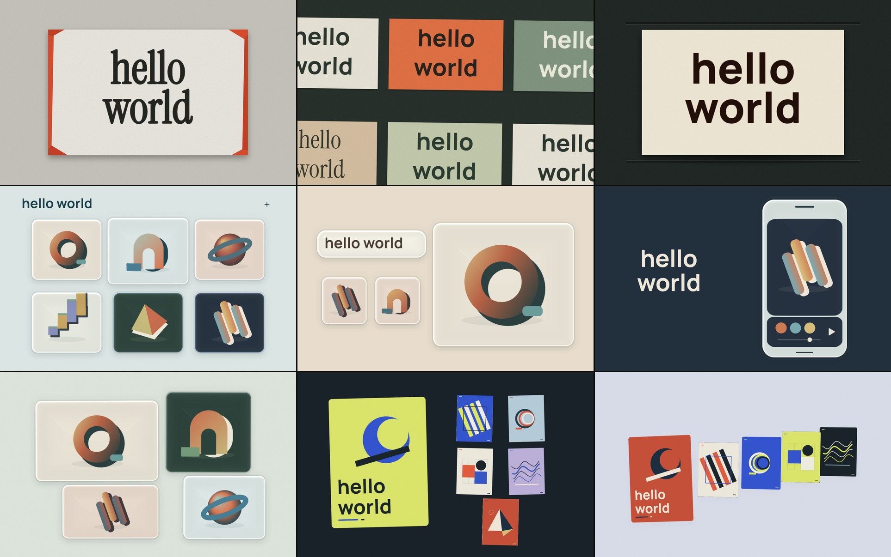

# Animation Card

85 张可编辑的动效卡片，全部画在 `<canvas>` 上。没有视频，没有贴图，没有外部依赖。

一个 448 KB 的 HTML 文件，双击就开。

**[▶ 在线试玩](https://mlf631666711-cloud.github.io/Animation-Card/)** · [卡片目录](CARDS.md) · [English](README.en.md)



---

## 这是什么

不是素材包。85 张卡，每张是一段独立的 canvas 绘制代码，共用同一个 `draw(ctx, t)` 接口，按时间参数出画面。

所以你打开以后能做这几件事：

- 拖时间轴，看这段动效在任意一帧长什么样
- 逐段跳。每张卡被切成 4–7 个段落，每个段落有名字
- 点右上「源码」，看这张卡的完整绘制代码，复制或下载
- 点「保存动效」，把当前这张卡导出成一个独立的 HTML 文件

第二件事和第三件事是这个库和普通动效预览的区别：它把"动效"拆成了可以复述的结构，而不是一段只能看不能改的视频。

## 一张卡由什么组成

每张卡的数据里有一组字段，描述的不是"看起来像什么"，而是这组画面之间的关系：

| 字段 | 它回答什么 | 例子（第 32 号「玻璃闸门换场」） |
|---|---|---|
| **起始画面** | 从哪来 | 深色双栏：作品在左、标题在右 |
| **最终落点** | 落到哪 | 浅色三卡转为主次拼版 |
| **衔接主体** | 靠什么接上下一镜 | 闸门的右侧边界同时结束旧镜并揭示新镜 |
| **起势动作** | 进入前那一下 | （这一项只有 15 张卡有） |
| **段落** | 内部有几个节拍 | 6 段 |
| **用途** | 在成片里干什么活 | 转场 |

**55 张卡写全了前三项。** 编号 1–20 的单技法卡在原始设计里就没有语义段落数据，播放器对它们显示时间百分比，不硬编成"动作节点"。这是缺口，不是省略。

段落标记可以拆开看。以第 32 号「玻璃闸门换场」为例：

| 段 | 时间 | 名字 |
|---|---|---|
| 01 | 0.00s | 双栏建立 |
| 02 | 1.35s | 闸门擦镜 |
| 03 | 2.65s | 三卡接住 |
| 04 | 3.70s | 主次重排 |
| 05 | 5.20s | 结果停靠 |
| 06 | 7.30s | 反向接回 |

## 六个系列

| 系列 | 数量 | 时长 | 干什么用 |
|---|---:|---|---|
| 基础实验 | 20 | 6s | 单技法研究，每张只演示一个动作原理，不带场景包装 |
| 多段编排 | 10 | 9.6s | 把单一技法拉成多段叙事 |
| 镜头与组件 | 15 | 8.6–9.4s | 界面级动效：卡片推入详情、窗口让位、多窗收束 |
| 快速卡片 | 15 | 6–7.4s | 快切：甩腕、撞边、穿框、鞭镜，用于密集剪辑换场 |
| 纯文字实验 | 15 | 3.4–4.8s | 只画文字和纯色底，没有卡片、面板、装饰 |
| 文字景别与角度 | 10 | 5.9–6.5s | 把文字当空间主体：绕行、纵深接力、仰俯视、斜角掠字 |

完整清单和每张卡的配方见 [CARDS.md](CARDS.md)。

## 操作

打开 `index.html` 就行。键盘：

| 键 | 作用 |
|---|---|
| `空格` | 播放 / 暂停 |
| `←` `→` | 逐帧 |
| `Shift` + `←` `→` | 逐秒 |
| `1`–`9` | 跳到第 N 段 |
| `R` | 重播 |
| `F` | 放大 |

URL 参数可以直接定位到某一帧，方便嵌进别的地方：

```
index.html?card=33&t=2.4          # 第 33 号卡，停在 2.4 秒
index.html?card=33&bare=1&t=2.4   # 同上，但隐藏所有控件
```
## 文件

```
index.html      85 张卡 + 播放器 + 源码查看器，单文件，448 KB
CARDS.md        卡片目录 + 55 张卡的完整配方
cards.json      机器可读的卡片数据（名称、用途、时长、段落、配方字段）
assets/         预览图和三个动效 GIF
```

`index.html` 里没有一条 `src=` 或 `href=` 指向外部文件。字体、样式、代码全在里面，断网也能开。

## 已知的限制

- **1–20 号没有语义段落**，只有时间百分比标记
- **只画了 `hello world` 和一组几何图形**。整个库共用一套测试内容，这是刻意的：同一份内容才能看出动效本身的差别，但也意味着它看起来重复度偏高
- **单张卡导出后不能再编辑配方**，导出的 HTML 只有这张卡的绘制代码，没有播放器和目录
- 移动端能开，但操作是按桌面键盘设计的

## 来源与授权

代码是自己写的。`collections/` 和 `type/` 下的每一张卡都是独立的 canvas 绘制，没有引用任何视频、截图或第三方绘制器。

内嵌的四款字体（Lab Grotesk / Lab Serif / Lab Condensed / Lab Mono）按 **SIL Open Font License 1.1** 分发，完整授权文本保留在 HTML 的样式块注释里。

代码部分用 MIT，见 [LICENSE](LICENSE)。
